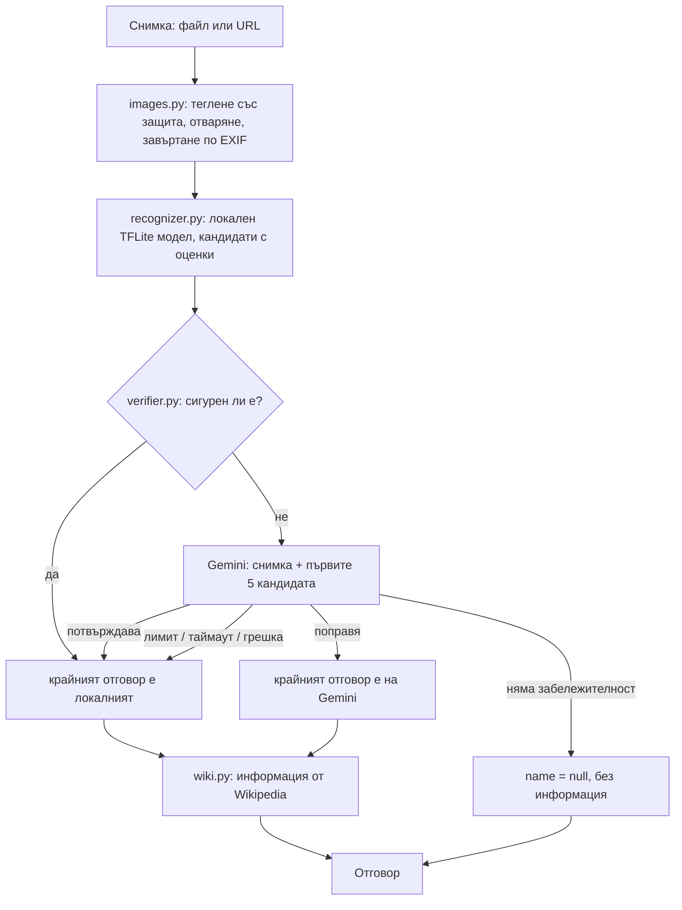

# Как работи

## Последователност на една заявка

Кодът на тази последователност е в `app/pipeline.py`.

## 1. Снимката (`app/images.py`)

- **Файл:** чете се до `MAX_UPLOAD_BYTES`.
- **URL:**
  - Google Images линкове (`google.com/imgres?...imgurl=...`) се разопаковат до истинската снимка.
  - Позволени са само `http`/`https` на портове 80 и 443.
  - **Защита от SSRF:** преди всяка заявка адресът се превежда до IP. Ако някое IP не е публично (localhost, 10.x, 172.16–31.x, 192.168.x, 169.254.x, ::1 и т.н.), заявката се отказва. Иначе някой би могъл да накара сървъра да чете вътрешни адреси, например metadata услугата на облака.
  - Пренасочванията (redirects) се следват ръчно, до 3, и всяко се проверява отново.
  - Ако сайтът върне HTML, грешката обяснява как да се копира адресът на самата снимка.
- **Отваряне:** Pillow; снимката се завърта според EXIF (снимки от телефон). Снимки над 100 мегапиксела се отказват (защита от „decompression bomb“).

## 2. Локалният модел (`app/recognizer.py`)

- Модел: [Google Landmarks classifier, Europe V1](https://www.kaggle.com/models/google/landmarks) (TFLite, 48 MB). Изпълнява се с [LiteRT](https://pypi.org/project/ai-edge-litert/) (бившият TensorFlow Lite runtime), без TensorFlow и без GPU.
- Вход: снимка 321×321, `uint8`. Изход: 99 125 оценки от 0 до 1.
- Имената са вградени в самия `.tflite` файл (той е и zip архив с `probability-labels-en.txt`).
- Една забележителност има няколко номера (99 125 номера, 33 543 уникални имена), затова за всяко име се пази най-високата оценка.
- Интерпретаторът не е thread-safe и е защитен с lock.
- Скорост: около 0.3–0.7 секунди на CPU.

## 3. Кога се вика Gemini

Правилата са в `verification_reasons()` в `app/verifier.py`. Резултатът е **несигурен**, ако:

1. **най-високата оценка е под `VERIFY_MIN_SCORE` (0.85)**, или
2. **най-високата оценка е под `VERIFY_SURE_SCORE` (0.95) и първите два кандидата са на по-малко от `VERIFY_MIN_MARGIN` (0.05) един от друг.**

Защо второто правило има горна граница: при много сигурни снимки и близките места получават висока оценка. На Айфеловата кула (0.99) мостът до нея има 0.97. Това е нормално, не е объркване.

| Пример | Оценки | Gemini? | Защо |
|---|---|---|---|
| Айфелова кула | 0.987 / 0.96 | не | над 0.95 |
| Александър Невски | 0.883 / 0.731 | не | над 0.85 и с голяма разлика |
| Ди Треви от ъгъл | 0.847 / 0.823 | да | под 0.85 и твърде близо |
| Колизеум | 0.755 / 0.741 | да | под 0.85 (Колизеумът го няма в модела) |

Параметърът `verify` в заявката може да замени правилата: `always` или `never`.

## 4. Gemini (`app/verifier.py`)

- Снимката се смалява до 1024 px и се праща заедно с **първите 5 кандидата**.
- Gemini избира един от кандидатите, дава друго име или казва, че няма забележителност. Когато има конкретни кандидати, моделът си измисля по-рядко, отколкото на въпрос „какво е това?“.
- В промпта изрично пише, че сграда точно зад по-известна забележителност (палат зад фонтан) се отчита като забележителността. Това е случаят Palazzo Poli / Trevi Fountain.
- **Структуриран изход:** отговорът е JSON по схемата `GeminiVerdict` (`app/schemas.py`), така че не се налага текст да се разчита.
- `temperature=0` дава по-стабилни отговори.
- Gemini връща и `wikipedia_title`: точното заглавие на статията в английската Wikipedia. Това е най-надеждният начин да се намери правилната информация.
- **Резервни модели:** опитва моделите от `GEMINI_MODELS` по ред. Минава на следващия при таймаут (`GEMINI_TIMEOUT_S`), 429 (изчерпан лимит) или 5xx. При друга грешка (например невалиден ключ) спира.
- **Нищо от Gemini не чупи заявката.** При каквато и да е грешка се връща локалният резултат, а `verification.status` е `error` с обяснение.

Как се осигурява нулев бюджет: [ZERO_BUDGET.md](ZERO_BUDGET.md).

## 5. Информация от Wikipedia (`app/wiki.py`)

1. Ако Gemini е дал `wikipedia_title`, статията се взима директно.
2. Иначе се търси името в английската Wikipedia (първите 5 резултата). Търсенето е неточно („Marcello Theater“ първо намира комик), затова резултат се приема само ако:
   - е място, т.е. статията има координати;
   - не е страница за многозначност;
   - е първият резултат **или** повече от половината думи от името се срещат в заглавието. Думите се сравняват по първите 5 букви, така че „Marcello Theater“ съвпада с „Theatre of Marcellus“.
3. От статията се взимат първите до 4 изречения, линк, снимка и координати.
4. Ако е поискан друг език (`lang=bg`) и има статия на него, заглавието, описанието и линкът са от нея. Английските остават в `english_title`/`english_url`.
5. Ако нищо не пасва: `{"found": false, "message": "Няма информация за тази забележителност"}`. По-добре никаква информация, отколкото грешна.

Резултатите се пазят в паметта (до 512), така че повтаряща се забележителност не вика Wikipedia отново. Неуспешните заявки не се пазят.

## 6. Настройки и зареждане (`app/config.py`, `app/main.py`)

- Настройките се четат веднъж при старт от environment variables и `.env`.
- Моделите се зареждат при старт (FastAPI lifespan) или при първата заявка, ако платформата не пусне lifespan. Във Vercel това става веднъж на „студен старт“ на инстанция: около 1.5 секунди за импортите и 1.5 за модела (мерено локално).
- Ендпойнтите са синхронни функции. FastAPI ги пуска в thread pool, така че бавен Gemini не блокира другите заявки.
